  <!-- ======================================================== -->
  <!-- 01 — HERO SECTION                                        -->
  <!-- ======================================================== -->
  <a href="https://github.com/tahirazeem145">
    <picture>
      <source srcset="./hero-banner.webp" type="image/webp">
      
    </picture>
  </a>

   

  #  TAHIR AZEEM 
  ### ⚡ Full Stack Developer &nbsp;×&nbsp; AI Builder
  *“Turning ideas into real, scalable products.”*

   

  

    <code>⚡ Experience: Full Stack & AI Systems</code> &nbsp;•&nbsp; <code>🚀 Focus: Software Engineering</code> &nbsp;•&nbsp; <code>📍 Location: Remote / Global</code>
  

   

  

    
    &nbsp;
    
    &nbsp;
    
    &nbsp;
    
  

   
  
    

  <!-- ======================================================== -->
  <!-- 02 — DEVELOPER SYSTEM // TAHIR_OS                        -->
  <!-- ======================================================== -->
  
  ## ⚙️ 02 // DEVELOPER SYSTEM [ TAHIR_OS ]
  
<em>Autonomous execution environment engineered for velocity, deep learning, and continuous evolution.</em>

  

   

  | 🎯 Directive | 📝 Description | 🚀 Status |
  | :--- | :--- | :---: |
  | **01 // Build Real Products** | Engineering functional, user-centric software that solves actual problems. | `ACTIVE` |
  | **02 // Learn Deeply** | Deconstructing fundamentals, mastering modern frameworks, and exploring LLM agents. | `ACTIVE` |
  | **03 // Ship Relentlessly** | Maintaining high deployment velocity through rapid, disciplined iteration loops. | `ACTIVE` |

   

  ### 🛠️ Tech Arsenal & Stack

  

    
    &nbsp;
    
    &nbsp;
    
    &nbsp;
    
    &nbsp;
    
    &nbsp;
    
    &nbsp;
    
  

   
  
    

  <!-- ======================================================== -->
  <!-- 03 — PROJECT GALAXY // ACTIVE BUILDS                     -->
  <!-- ======================================================== -->

  ## 🚀 03 // PROJECT GALAXY [ ACTIVE BUILDS ]
  
<em>Curated lineup of flagship applications, intelligent AI products, and developer utilities.</em>

  

   

  | 🛸 Project | 🛠️ Tech Stack | 📌 Type & Overview | 🔗 Links |
  | :--- | :--- | :--- | :---: |
  | **TripNest 2.0**  *(Flagship)* | `React` `Vite` `Tailwind CSS` `Supabase` `PostgreSQL` | **Travel Photo Sharing Community Platform** Geo-synced photo sharing, community feeds, and social travel networks. | [View Project](https://github.com/tahirazeem145) &nbsp;·&nbsp; [Source](https://github.com/tahirazeem145) |
  | **HireMind AI** | `AI Product` `LLMs` `Next.js` `APIs` | **AI-Powered Career Coach** Intelligent career guidance, automated resume critique, and interview simulator. | [View Project](https://github.com/tahirazeem145) &nbsp;·&nbsp; [Source](https://github.com/tahirazeem145) |
  | **QR Web Tool** | `Web Tool` `JavaScript` `Modern UI` | **Modern QR Code Generator** High-performance, customizable vector QR code generator for digital workflows. | [View Project](https://github.com/tahirazeem145) &nbsp;·&nbsp; [Source](https://github.com/tahirazeem145) |

   
  
    

  <!-- ======================================================== -->
  <!-- 04 — CONTRIBUTION SNAKE // AUTONOMOUS GAME               -->
  <!-- ======================================================== -->

  ## 🐍 04 // CONTRIBUTION GRAPH [ AUTONOMOUS GAME ]
  
<em>Autonomous daily visualization of GitHub activity, commit streaks, and continuous momentum.</em>

  

    

  

   
  

    <code>Streak: Perpetual</code> &nbsp;•&nbsp; <code>Focus: Clean Code & High Velocity</code> &nbsp;•&nbsp; <code>Cadence: Daily Commits</code>
  

   
  
    

  <!-- ======================================================== -->
  <!-- 05 — BUILDER MINDSET // THE PHILOSOPHY                   -->
  <!-- ======================================================== -->

  ## 🧠 05 // BUILDER MINDSET [ THE PHILOSOPHY ]

  <blockquote>
    <strong>“I don't just write code. I build things people can use. Ideas are cheap — building is the difference.”</strong>
  </blockquote>

  

   

  | 🔄 Stage | 💡 Name | 📖 Philosophy Directive |
  | :---: | :--- | :--- |
  | `01` | **THINK** | Understand the core problem and user needs before writing a single line of code. |
  | `02` | **ARCHITECT** | Structure scalable systems, modular data models, and clean component hierarchies. |
  | `03` | **EXECUTE** | Turn architecture into clean, high-velocity code using modern industry standards. |
  | `04` | **TEST & BREAK** | Stress-test edge cases and potential failure modes to guarantee rock-solid stability. |
  | `05` | **ITERATE** | Continuously refine performance, user experience, and architecture based on telemetry. |
  | `06` | **SHIP** | Deploy production-ready value to users and repeat the perpetual build cycle. |

   
  
    

  <!-- ======================================================== -->
  <!-- 06 — CONNECTION // TERMINAL INVITATION                   -->
  <!-- ======================================================== -->

  ## 📡 06 // CONNECTION [ TERMINAL INVITATION ]
  
<em>Open for high-impact product builds, full-stack web applications, AI integrations, and visionary collaborations.</em>

  

    

  ### ✦ LET'S CONNECT & BUILD TOGETHER ✦

  [**⌥ GitHub**](https://github.com/tahirazeem145) &nbsp;·&nbsp;
  [**💼 LinkedIn**](https://in.linkedin.com/in/tahirazeem-r) &nbsp;·&nbsp;
  [**✉️ Email**](mailto:tahirazeems145s@gmail.com) &nbsp;·&nbsp;
  [**🌐 Portfolio**](https://tahirazeemportfolio.vercel.app)

    
  © 2026 Tahir Azeem • System Status: Nominal • Autonomous Builder

