  <!-- ======================================================== -->
  <!-- 01 — HERO SECTION                                        -->
  <!-- ======================================================== -->
  <a href="https://github.com/tahirazeem145">
    <picture>
      <source srcset="./hero-banner.webp" type="image/webp">
      
    </picture>
  </a>

   

  #  TAHIR AZEEM 
  ### ⚡ Software Engineer &nbsp;×&nbsp; MERN Stack Developer
  *“Architecting scalable full-stack applications with clean, production-ready code.”*

   

  

    <code>⚡ Role: Software Engineer</code> &nbsp;•&nbsp; <code>🚀 Focus: MERN Stack Engineering</code> &nbsp;•&nbsp; <code>📍 Location: Remote / Global</code>
  

   

  

    
    &nbsp;
    
    &nbsp;
    
    &nbsp;
    
  

   
  
    

  <!-- ======================================================== -->
  <!-- 02 — DEVELOPER SYSTEM // TAHIR_OS                        -->
  <!-- ======================================================== -->
  
  ## ⚙️ 02 // DEVELOPER SYSTEM [ TAHIR_OS ]
  
<em>Autonomous execution environment engineered for velocity, deep learning, and continuous evolution.</em>

  

    

  | 🎯 Directive | 📝 Description | 🚀 Status |
  | :--- | :--- | :---: |
  | **01 // Build Real Products** | Engineering functional, user-centric software that solves actual problems. | `ACTIVE` |
  | **02 // Master MERN Fundamentals** | Deconstructing fundamentals, mastering React, Node.js, Express, and MongoDB architectures. | `ACTIVE` |
  | **03 // Ship Relentlessly** | Maintaining high deployment velocity through rapid, disciplined iteration loops. | `ACTIVE` |

   

  ### 🛠️ Tech Arsenal & Stack

  

    
    &nbsp;
    
    &nbsp;
    
    &nbsp;
    
    &nbsp;
    
    &nbsp;
    
    &nbsp;
    
  

   
  
    

  <!-- ======================================================== -->
  <!-- 03 — PROJECT GALAXY // ACTIVE BUILDS                     -->
  <!-- ======================================================== -->

  ## 🚀 03 // PROJECT GALAXY [ ACTIVE BUILDS ]
  
<em>Curated lineup of flagship intelligent applications, version-aware engines, and traffic advisory platforms.</em>

  

    

  | 🛸 Project | 🛠️ Tech Stack | 📌 Type & Overview | 🔗 Links |
  | :--- | :--- | :--- | :---: |
  | **AquaGuard-AI**  *(Flagship)* | `React 19` `FastAPI` `PyTorch` `MobileNetV3` `Vite` | **Multimodal Aquaculture Early Warning & Diagnostics** Deep learning fish lesion vision (98.28% test accuracy), aqueous ammonia thermodynamics, biological synergy modeling, and precision treatment dosing across 12 languages. | [View Project](https://github.com/tahirazeem145/AquaGuard-AI) &nbsp;·&nbsp; [Source](https://github.com/tahirazeem145/AquaGuard-AI) |
  | **RouteWise** | `React` `Node.js` `Express` `TomTom APIs` `REST` | **Intelligent Traffic-Aware Route Recommendation Platform** Dynamic multi-route alternative ranking by Adjusted ETA, switch-threshold flapping prevention, and community incident crowdsourcing with 2-vote verification. | [View Project](https://github.com/tahirazeem145/Route-Wise) &nbsp;·&nbsp; [Source](https://github.com/tahirazeem145/Route-Wise) |
  | **RAGNext** | `React 18` `Node.js` `Express` `PostgreSQL` `ChromaDB` | **Version-Aware Document Intelligence Engine** Enterprise RAG solving multi-version policy conflicts through temporal validity enforcement, document revision lineage tracking, and verifiable page citations. | [View Project](https://github.com/Sainathloganathan/RAGNext) &nbsp;·&nbsp; [Source](https://github.com/Sainathloganathan/RAGNext) |

   

  ### 🔍 Detailed Project Architecture & Capabilities

  

  
<strong>🐟 01. AquaGuard-AI — Multimodal Aquaculture Early Warning & Diagnostics</strong>

   

  - **Core Innovation**: An intelligent multimodal early-warning and antibiotic-free treatment platform designed for freshwater aquaculture ponds (protecting species such as Rohu, Catla, and Tilapia).
  - **Computer Vision Diagnostics**: Fine-tuned **MobileNetV3-Large** deep neural network achieving **98.28% test accuracy** on macroscopic fish lesions (Fin Rot, Epizootic Ulcerative Syndrome / EUS, Columnaris, and healthy specimens).
  - **Physicochemical Modeling**: Uses the **Emerson Thermodynamic Model** to determine toxic un-ionized ammonia ($NH_3$) equilibrium from pH and temperature data, providing proactive risk triage before biological stress occurs.
  - **Prescriptive Guidance**: Comprehensive pond dosing calculations, natural biological synergy recommendations, and multi-lingual localized interfaces supporting **12 languages**.
  - **Tech Stack**: `Python 3.12+`, `FastAPI`, `PyTorch`, `React 19`, `Vite`, `Tailwind CSS`.
  

   

  

  
<strong>🚦 02. RouteWise — Intelligent Traffic-Aware Route Recommendation & Community Advisory</strong>

   

  - **Core Innovation**: High-velocity traffic intelligence API and interactive commuter dashboard evaluating, ranking, and visualizing route alternatives with live congestion delays.
  - **Route Ranking Overhaul**: Eliminates provider double-counting by calculating true Adjusted ETA with dynamic delay factors, coupled with a strict **Switch Threshold** (`timeSaved >= max(180s, 0.10 * mainRouteEta)`) to prevent recommendation flapping.
  - **Community Incident Verification**: Crowdsourced reporting across 6 critical incident categories (congestion, roadblocks, roadwork, processions, signal failures, waterlogging) with 100m spatial deduplication and a **2-vote or telemetry-backed validation engine**.
  - **Authority Hotspot Triage**: Municipal dispatch dashboard for real-time corridor monitoring and native Google Maps navigation handoff.
  - **Tech Stack**: `Node.js`, `Express.js`, `React`, `TomTom Routing & Search APIs`, `RESTful Architecture`.
  

   

  

  
<strong>🛡️ 03. RAGNext — Version-Aware Document Intelligence Engine</strong>

   

  - **Core Innovation**: Solves a critical flaw in conventional RAG systems where semantic cosine similarity naively pulls outdated clauses from superseded document versions.
  - **Temporal & Lineage Tracking**: Tracks document revision lineages (`v1.0` ➔ `v2.0` ➔ `v3.0`), enforces temporal validity rules, and detects conflicting active policy versions.
  - **Verifiable Evidence Grounding**: Answers queries strictly backed by exact page-level citations, section breadcrumbs, and verifiable supporting excerpts.
  - **Flexible Storage & Vector Ingestion**: Multi-format ingestion (PDF, DOCX, PPTX, Markdown) with embedded persistent vector storage and hybrid PostgreSQL / local SQLite adapters.
  - **Tech Stack**: `React 18`, `Node.js`, `Express.js`, `PostgreSQL / SQLite`, `ChromaDB API`, `Vite`, `Bootstrap 5`.
  

   
  
    

  <!-- ======================================================== -->
  <!-- 04 — CONTRIBUTION SNAKE // AUTONOMOUS GAME               -->
  <!-- ======================================================== -->

  ## 🐍 04 // CONTRIBUTION GRAPH [ AUTONOMOUS GAME ]
  
<em>Autonomous daily visualization of GitHub activity, commit streaks, and continuous momentum.</em>

  

    

  

   
  

    <code>Streak: Perpetual</code> &nbsp;•&nbsp; <code>Focus: Clean Code & High Velocity</code> &nbsp;•&nbsp; <code>Cadence: Daily Commits</code>
  

   
  
    

  <!-- ======================================================== -->
  <!-- 05 — BUILDER MINDSET // THE PHILOSOPHY                   -->
  <!-- ======================================================== -->

  ## 🧠 05 // BUILDER MINDSET [ THE PHILOSOPHY ]

  <blockquote>
    <strong>“I don't just write code. I build things people can use. Ideas are cheap — building is the difference.”</strong>
  </blockquote>

  

    

  | 🔄 Stage | 💡 Name | 📖 Philosophy Directive |
  | :---: | :--- | :--- |
  | `01` | **THINK** | Understand the problem before writing the solution. |
  | `02` | **BUILD** | Turn raw ideas into working products. |
  | `03` | **BREAK** | Expect fragile things to fail under pressure. |
  | `04` | **LEARN** | Deconstruct the failure and understand why. |
  | `05` | **IMPROVE** | Iterate relentlessly. Make next version better. |
  | `06` | **SHIP** | Real products belong in the real world. |

   
  
    

  <!-- ======================================================== -->
  <!-- 06 — CONNECTION // TERMINAL INVITATION                   -->
  <!-- ======================================================== -->

  ## 📡 06 // CONNECTION [ TERMINAL INVITATION ]
  
<em>Open for high-impact software engineering roles, full-stack MERN builds, scalable web applications, and visionary collaborations.</em>

  

    

  ### ✦ LET'S CONNECT & BUILD TOGETHER ✦

  [**⌥ GitHub**](https://github.com/tahirazeem145) &nbsp;·&nbsp;
  [**💼 LinkedIn**](https://in.linkedin.com/in/tahirazeem-r) &nbsp;·&nbsp;
  [**✉️ Email**](mailto:tahirazeems145s@gmail.com) &nbsp;·&nbsp;
  [**🌐 Portfolio**](https://tahirazeemportfolio.vercel.app)

    
  © 2026 Tahir Azeem • System Status: Nominal • Autonomous Builder

